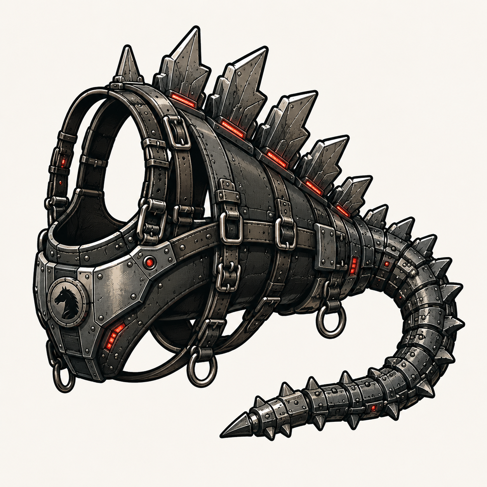

# MechaHarness



A Python agent harness for local and cloud models, with tool grants, cost
accounting, event logs, and resumable execution graphs. Provider I/O and agent
loop policy are separate, configurable components.

## Install and try it

Requires Python 3.9+.

```bash
pip install mechaharness
mechaharness run "Hello" --backend mock --family pass_through --model mock
```

The mock backend needs no API key or GPU. For real inference, see
[installation](docs/guides/install.md) and
[OpenAI or local models](docs/guides/openai-local.md).

```python
import asyncio
from mechaharness import RunRequest, run

async def main():
    result = await run(RunRequest(
        prompt="Hello", backend="mock", family="pass_through", model="mock"
    ))
    print(result.final_text)

asyncio.run(main())
```

## Integrate with a host

- [Dependency injection](docs/guides/dependency-injection.md): bind provider,
  harness, grants, tools, and policies through `MechaHarnessConfig`.
- [Durable graph generators](docs/reference/durable-graph-generators.md): start,
  pause, resume, and inspect long-running work.
- [Agentic Recipes](docs/reference/graph-templates.md): reusable control graphs.
- [Host-agent skills](agent-skills/): integration instructions for downstream
  coding agents.
- [CLI](docs/reference/cli.md) and [HTTP API](docs/reference/api.md).

Full documentation: [rl337.org/mechaharness](https://rl337.org/mechaharness/).
Executable acceptance walks: [user stories](docs/guides/user-stories.md).

## Develop

```bash
python -m venv .venv
source .venv/bin/activate
pip install -e '.[dev,docs]'
MECHA_STORY_BACKEND=static ./run_checks.sh
```

See [story authoring](docs/guides/authoring-user-stories.md) and
[release preparation](docs/guides/release-preparation.md). Operator credentials
belong in the environment or ignored local files; `.env.example` is a template.
