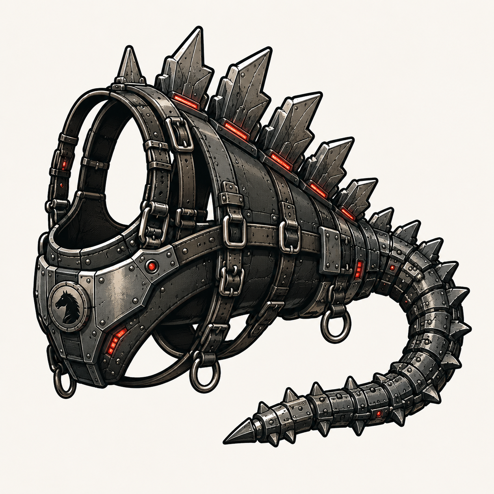

# MechaHarness documentation

MechaHarness composes local or cloud inference with agent-loop policy, tool
grants, cost accounting, event logs, and resumable graphs. The
[published documentation](https://rl337.org/mechaharness/) includes the generated
Python API reference.

## Start here

- [Install and run](./guides/install.md)
- [OpenAI and local model setup](./guides/openai-local.md)
- [Configure a host with dependency injection](./guides/dependency-injection.md)
- [Architecture](./architecture.md)
- [Host-agent skills](./guides/agent-skills.md)

## Use the library

- [CLI](./reference/cli.md), [HTTP API](./reference/api.md)
- [Agentic Recipes](./reference/graph-templates.md)
- [Durable generators](./reference/durable-graph-generators.md),
  [stepped execution](./reference/stepped-graph-execution.md)
- [Access](./reference/access.md), [cost](./reference/cost.md),
  [budget](./reference/budget.md), [events](./reference/events.md)
- [Judge lane](./reference/judge.md), [job lanes](./reference/job-lanes.md)
- [Experimental research reports](./api/research_helpers.rst)

## Acceptance and maintenance

- [User stories](./guides/user-stories.md)
- [Author a story](./guides/authoring-user-stories.md)
- [Coding suites](./guides/coding-delegate-suites.md)
- [Gastronomic comparison](./guides/gastronomic-comparison.md)
- [Prepare a release](./guides/release-preparation.md)
- [Host requirements](./requirements/host-integration.md)
- [Repository hygiene](./requirements/repository-secrets-hygiene.md)
- [Inspiration import guide](./reference/inspiration-primitives.md)
- [Trouble research, attribution, and open requirements](./inspiration/trouble.md)

The published site groups every requirement and inspiration note separately
from task-oriented integration guides. Inspiration records source claims;
current API contracts and acceptance stories define implemented behavior.
