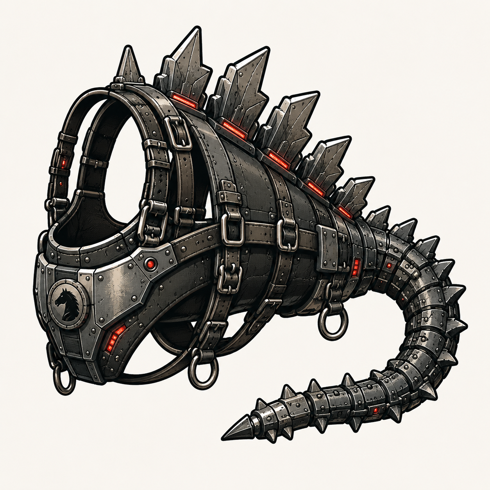

# MechaHarness docs

MechaHarness is a Python **agent harness** for hosts that must compose
inference safely — not a thin chat-client wrapper. Provider I/O, agent-loop
policy, cost accounting, and telemetry are first-class seams so you can swap
models and policies without rewriting the run path, and so agents cannot
quietly burn unbounded spend.

Published site: [https://rl337.org/mechaharness/](https://rl337.org/mechaharness/)

## Founding principles

1. **Modular through dependency injection.** Wiring is pyiv
   `MechaHarnessConfig` and constructor injection. Hosts subclass Config hooks
   to bind strategies, harnesses, connections, and providers — they do not fork
   closed enums or grow string registries. See
   [Dependency injection](./guides/dependency-injection.md) and
   [Architecture](./architecture.md).

2. **Multi-model and lanes are native.** Reason, judge, and media (plus
   host-named lanes) are first-class via `InferenceEnvironment.active_lane()`.
   Generative work yields a `Completion`; closed-world decide yields a
   `Judgement`; media yields a `Generation`. Swap `InferenceStrategy` or
   `JudgeProvider` without rewriting the harness loop. See
   [Judge](./reference/judge.md) and [Architecture](./architecture.md).

3. **Cost lives in the object model.** Ability-scaled units and
   `CostAccountant` sit on the harness path so every inference and tool
   invocation is priced as it happens — designed to keep agents from going AWOL
   with unbounded spend. See [Cost](./reference/cost.md).

4. **Event logging and telemetry are built in.** A queryable `EventLog` records
   agent lifecycle, inference, tools, cost, and access checks on every run —
   telemetry is part of the product surface, not a bolt-on sink. See
   [Event log](./reference/events.md).

Also in the core model: deny-by-default grants and `CompoundPolicy`
([Access control](./reference/access.md)), host-extendable open identity
for events and grants ([Architecture](./architecture.md)), and **Agentic
Recipes** — reusable control subgraphs on a `GraphTemplate` substrate
([Graph templates and Agentic Recipes](./reference/graph-templates.md)).

## Downstream consumers

Hosts that **depend on** MechaHarness (consoles, warehouses, product agents)
should start here — not in the maintainer `.cursor/skills/` tree.

| Page | Description |
|------|-------------|
| [Agent skills for your project](./guides/agent-skills.md) | Install `use-mechaharness` / observability skills + `mechaharness.mdc` from GitHub `main` |
| [Host integration requirements](./requirements/host-integration.md) | HOST-01..07: Config-first, `host_apis`, promote path, open identity, OBS export |
| [`agent-skills/` on GitHub](https://github.com/rl337/mechaharness/tree/main/agent-skills) | Copy-paste skill sources for Cursor/Codex in *your* repo |

Related: [Dependency injection](./guides/dependency-injection.md),
[Inspiration primitives](./reference/inspiration-primitives.md),
[Event analytics schema](./requirements/event-analytics-schema.md).

## Contents

| Page | Description |
|------|-------------|
| [Architecture](./architecture.md) | Inference Strategy, harness hierarchy, recipes, pyiv Config |
| [Inspiration requirements map](./inspiration/requirements-map.md) | Blog-inspired reqs → modules → library vs client ownership |
| [Recipes and decision plane](./requirements/recipes-and-decision-plane.md) | Agentic Recipes (`GraphTemplate` substrate), DP/RT reference recipes |
| [Dependency injection](./requirements/dependency-injection.md) | Config bind + inject; no getattr caches or `get_*` composition (DI-01..08) |
| [Dynamic tool graph and node components](./requirements/dynamic-tool-graph.md) | Graph node vs node component; HF-05/07/08; kinds ⊆ existing surfaces |
| [Transactional durable resume](./requirements/transactional-durable-resume.md) | CheckpointStore, SQLite, effect reconciliation (DR-01..12) |
| [Event analytics schema](./requirements/event-analytics-schema.md) | Near-3NF fact/dim contract for warehouse reconstruction of graph decisions |
| [Host integration](./requirements/host-integration.md) | Normative contract for apps that consume MechaHarness (HOST-01..07) |
| [Agent skills (downstream)](./guides/agent-skills.md) | Customer-facing Cursor skills for host repos |
| [Inspiration primitives](./reference/inspiration-primitives.md) | Leaf → map ID → DI? → blessed import |
| [June host-friction inspiration](./inspiration/june-host-friction-inspiration.md) | June HF pack provenance; console consumer vs MH ownership |
| [June host-friction requirements map](./inspiration/june-host-friction-requirements-map.md) | HF-* → modules → user stories |
| [WalkingLabs Harness Engineering inspiration](./inspiration/walkinglabs-harness-engineering-inspiration.md) | 50-point source-attributed audit of the online book against current MechaHarness |
| [Eval research brief](./inspiration/eval-research.md) | Anthropic-inspired research handoff for reusable evaluator/evidence/verdict primitives |
| [WalkingLabs + eval requirements map](./inspiration/walkinglabs-eval-requirements-map.md) | Backlog IDs → modules → user stories for WalkingLabs P0–P2 and eval substrate |
| [Multi-harness RL inspiration](./inspiration/multi-harness-rl-inspiration.md) | FineEnvs / Hugging Face multi-harness RL audit → MH-MHRL requirements |
| [FineEnvs MH-MHRL requirements map](./inspiration/fineenvs-mh-mhrl-requirements-map.md) | MH-MHRL IDs → modules → user stories for evaluation/rollout/capture gaps |
| [Jev typed-judgment inspiration](./inspiration/jev-typed-judgment-inspiration.md) | Typed decision calls, Jev attribution, MH-JEV foundation + domain packs |
| [Jev typed-judgment requirements map](./inspiration/jev-typed-judgment-requirements-map.md) | MH-JEV IDs → judge/`decision_plane` modules → user stories |
| [Personal agent reliability inspiration](./inspiration/personal-agent-reliability-inspiration.md) | Always-on personal agent execution patterns (MH-PA-*) |
| [Personal agent reliability requirements map](./inspiration/personal-agent-reliability-requirements-map.md) | MH-PA IDs → modules → user stories |
| [OpenAI Dots agent safety inspiration](./inspiration/openai-dots-agent-safety-inspiration.md) | Scoped execution and agent safety (MH-DOTS-*) |
| [OpenAI Dots agent safety requirements map](./inspiration/openai-dots-agent-safety-requirements-map.md) | MH-DOTS IDs → modules → user stories |
| [Self-revising recipe evolution inspiration](./inspiration/self-revising-recipe-evolution.md) | Evaluation-driven recipe evolution (proposal; unverified source) |
| [Self-revising recipe requirements map](./inspiration/self-revising-recipe-requirements-map.md) | MH-SR IDs → modules → user stories |
| [Install & quick start](./guides/install.md) | Environment setup and first run |
| [Local OpenAI-compat (`openai_local`)](./guides/openai-local.md) | Named OpenAI-compat LAN backend + live tests |
| [User stories](./guides/user-stories.md) | Persona narratives (Nubble, Fangore, Taloneth) + dual-mode suite |
| [Dependency injection](./guides/dependency-injection.md) | Config hooks vs OpenAPI `run()` |
| [CLI reference](./reference/cli.md) | `mechaharness` commands |
| [HTTP API reference](./reference/api.md) | FastAPI routes |
| [Event log](./reference/events.md) | Structured `EventLog` emit / query |
| [Cost](./reference/cost.md) | Ability units, `CostAccountant`, `core:cost` |
| [Access control](./reference/access.md) | Namespaced grants, `AccessControl`, `core:access_check` |
| [Judge](./reference/judge.md) | `judge()`, System One, JudgementPolicy, lanes |
| [Graph templates and Agentic Recipes](./reference/graph-templates.md) | Recipe catalog + `GraphTemplate` substrate + soft points |
| [Node components](./reference/node-components.md) | Sub-node kinds (events/soft points/nest); query + traversal |

## Mental model

1. **Inference Strategy** — pluggable backends (`openai`, `anthropic`, `lmstudio`, `vllm`, `ollama`, …)
2. **Harness family** — agent-loop policy (`pass_through`, `tool_loop`, `react`, `openai_tools`, `anthropic_tools`)
3. **Execution graph** — durable plans via `GraphExecutor` + host node runners (see [Architecture](./architecture.md))
4. **Agentic Recipes** — reusable control subgraphs (`GraphTemplate` substrate); tile into graphs
5. **Frontends** — Typer CLI and FastAPI share `RunRequest` / `mechaharness.factory.run`
6. **DI** — `MechaHarnessConfig` binds interfaces; see [Dependency injection](./guides/dependency-injection.md)

Normalized types in `mechaharness.core.types` are the portable contract for future language bindings.
